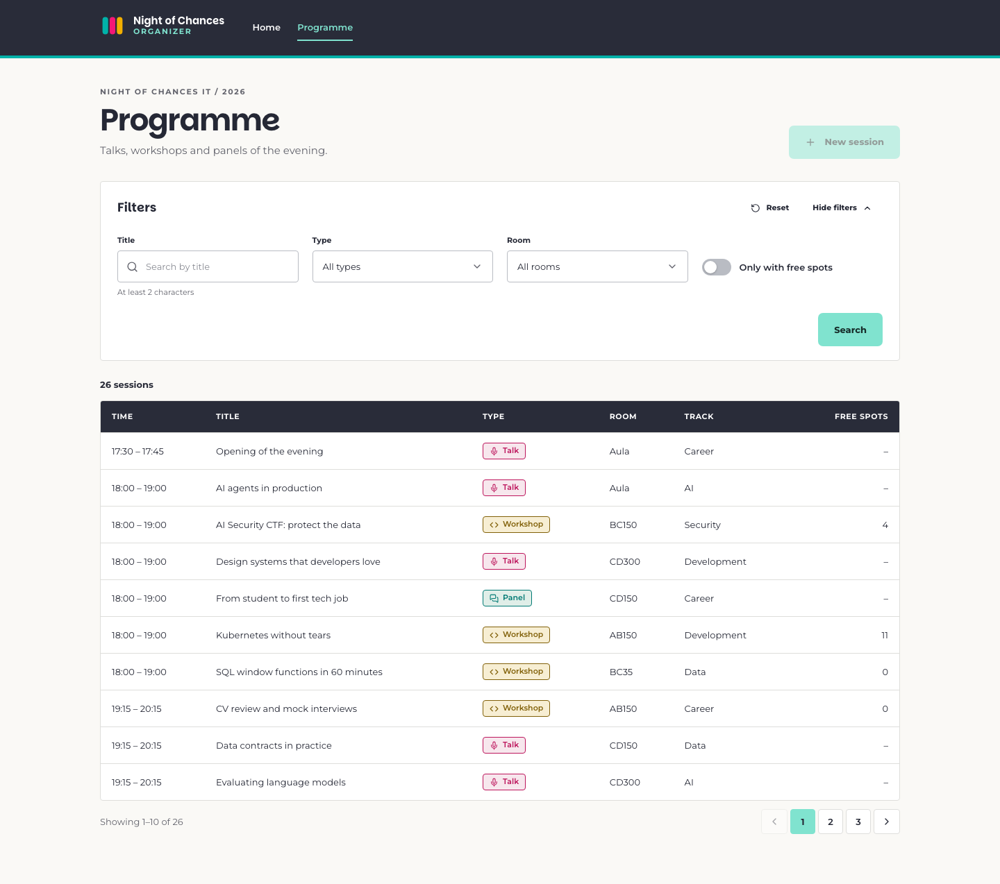

# PROG-12 – Programme list

Route: `/programme` · Mockup: [`mockups/01-programme-list.png`](mockups/01-programme-list.png) ·
Operation: `searchSessions`

## 1. Page

| Element     | Value |
|-------------|-------|
| Eyebrow     | `Night of Chances IT / 2026` |
| Title       | `Programme` |
| Description | `Talks, workshops and panels of the evening.` |
| Action      | `New session` – primary, plus icon; **disabled**, tooltip `Coming soon` (out of scope) |

## 2. Filters

A collapsible filter panel titled `Filters`, with `Reset` and `Hide filters` / `Show filters`. The filters
apply **automatically** about 400 ms after the last change – there is no search button. While new results
load, the previous results stay visible.

| Field                  | Control | Default      | Rules and behaviour |
|------------------------|---------|--------------|---------------------|
| `Title`                | text, search icon, placeholder `Search by title`, help text `At least 2 characters` | empty | Leading and trailing spaces are ignored. When not empty, at least 2 characters, otherwise the error `Enter at least 2 characters` and no search. Matches any part of the title, case-insensitive. |
| `Type`                 | select  | `All types`  | `All types`, `Talk`, `Workshop`, `Panel` |
| `Room`                 | select  | `All rooms`  | `All rooms`, then the rooms in contract order; `AULA` is shown as `Aula`, the others as their code (`CD300`, …) |
| `Only with free spots` | switch  | off          | When on, only sessions that still have free spots. |

`Reset` restores all defaults. The filters combine with AND.

## 3. Results table

Above the table, the result count: `{n} sessions` (`1 session`). Ten rows per page; paging with page numbers
and `Showing 1–10 of {n}`. Sessions are ordered by start time, then by title (the backend does it).

| Column       | Value |
|--------------|-------|
| `Time`       | `startsAt` – `endsAt`, e.g. `18:00 – 19:00` |
| `Title`      | `title` |
| `Type`       | tag: `Talk` – pink, microphone icon · `Workshop` – yellow, code icon · `Panel` – mint, speech-bubbles icon |
| `Room`       | `room` (`AULA` → `Aula`) |
| `Track`      | `AI`, `Security`, `Development`, `Data`, `Career` |
| `Free spots` | `freeSpots`, right-aligned; `–` when `null` (no registration needed); `0` when full |

Clicking a row – or pressing Enter on a focused row – opens the [Session detail](02-session-detail.md).

## 4. States

| State      | Display |
|------------|---------|
| Loading (first load) | Skeleton rows in the table. |
| Loading (filters or page changed) | Previous rows stay, dimmed. |
| No results | `No sessions match your filters` with the text `Try a different title, type or room.` |
| Error      | Error message `The programme could not be loaded` with the button `Try again`. |

## 5. URL

Filters and page are kept in the query string; default values are omitted:

| Parameter | Example          | Meaning |
|-----------|------------------|---------|
| `title`   | `title=agents`   | Title filter (only when valid) |
| `type`    | `type=WORKSHOP`  | Type filter |
| `room`    | `room=CD300`     | Room filter |
| `free`    | `free=true`      | Only with free spots |
| `page`    | `page=2`         | Page, **1-based**; changing a filter returns to page 1 |

Invalid parameter values are ignored (treated as the default).

## 6. Backend integration

`searchSessions` – `GET /api/programme/sessions` with query parameters `title`, `type`, `room`,
`onlyWithFreeSpots`, `page` (0-based), `size` (`10`). Parameters with default values are not sent. The response
contains the page of `items` and `totalCount`.
