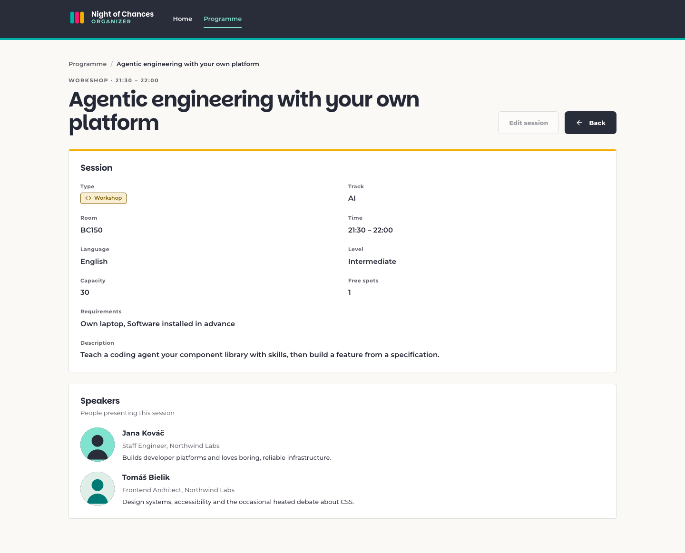

# PROG-12 – Session detail

Route: `/programme/{sessionId}` · Mockup: [`mockups/02-session-detail.png`](mockups/02-session-detail.png) ·
Operations: `getSession`, `getSpeaker`

## 1. Page

| Element     | Value |
|-------------|-------|
| Breadcrumbs | `Programme` (link to the list, with its filters and page) / session `title` |
| Eyebrow     | type label and time, e.g. `Workshop · 18:00 – 19:00` |
| Title       | session `title` |
| Actions     | `Edit session` – **disabled**, tooltip `Coming soon` (out of scope) · `Back` – dark, back-arrow icon, returns to the list with its filters and page |

## 2. Session section

Section `Session`, with a top accent in the colour of the session type (Talk pink, Workshop yellow, Panel mint).
Label/value pairs in two columns; missing values show `–`.

| Label          | Value |
|----------------|-------|
| `Type`         | type tag, as in the list |
| `Track`        | track label, as in the list |
| `Room`         | `room` (`AULA` → `Aula`) |
| `Time`         | `startsAt` – `endsAt`, e.g. `18:00 – 19:00` |
| `Language`     | `EN` → `English`, `SK` → `Slovak` |
| `Level`        | `BEGINNER` → `Beginner`, `INTERMEDIATE` → `Intermediate`, `ADVANCED` → `Advanced` |
| `Capacity`     | `capacity`; `–` when `null` |
| `Free spots`   | `freeSpots`; `–` when `null` |
| `Requirements` | `requirements` joined with `, `; `–` when empty |
| `Description`  | `description`, full width |

## 3. Speakers section

Section `Speakers` with the description `People presenting this session`. One row per speaker, in the order
of `speakerIds`:

- photo (`photoUrl`), or initials when there is no photo,
- `fullName` in bold,
- `{jobTitle}, {company}` in muted text,
- `bio` below.

| Situation                         | Display |
|-----------------------------------|---------|
| Session has no speakers           | Text `No speakers assigned yet.` |
| Speakers are loading              | Skeleton in place of the section. |
| One or more speakers failed to load | Warning `Some speaker details could not be loaded` at the top of the section; the speakers that loaded are shown. |

## 4. States

| State              | Display |
|--------------------|---------|
| Loading            | Title `Session`, skeletons in place of both sections. |
| Session not found (HTTP 404) | Title `Session`, message `Session not found` with the text `It may have been removed from the programme.` and the button `Back to programme`. |
| Other error        | Title `Session`, error `The session could not be loaded` with the button `Try again`. |

## 5. Backend integration and call order

1. `getSession` – `GET /api/programme/sessions/{sessionId}`.
2. After it succeeds: `getSpeaker` – `GET /api/programme/speakers/{speakerId}` for every id in `speakerIds`,
   in parallel.

A failing `getSpeaker` never hides the session.
