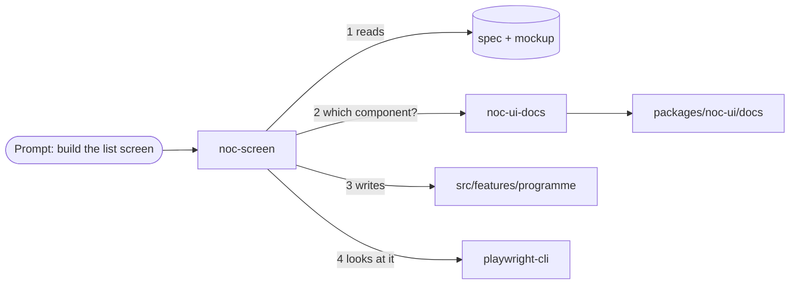
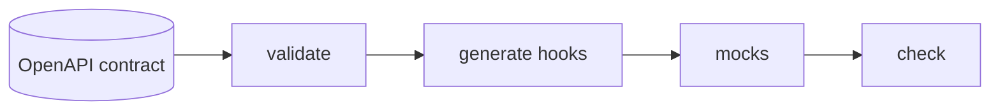

```text
+==[ NIGHT OF AGENTS // MODULE 01 ]=========[ PLATFORM: NOC ]==[ LIBRARY: noc-ui ]==[ SKILLS: 4 ]=+

██████╗ ██╗      █████╗ ████████╗███████╗ ██████╗ ██████╗ ███╗   ███╗
██╔══██╗██║     ██╔══██╗╚══██╔══╝██╔════╝██╔═══██╗██╔══██╗████╗ ████║
██████╔╝██║     ███████║   ██║   █████╗  ██║   ██║██████╔╝██╔████╔██║
██╔═══╝ ██║     ██╔══██║   ██║   ██╔══╝  ██║   ██║██╔══██╗██║╚██╔╝██║
██║     ███████╗██║  ██║   ██║   ██║     ╚██████╔╝██║  ██║██║ ╚═╝ ██║
╚═╝     ╚══════╝╚═╝  ╚═╝   ╚═╝   ╚═╝      ╚═════╝ ╚═╝  ╚═╝╚═╝     ╚═╝
███████╗██╗  ██╗██╗██╗     ██╗     ███████╗
██╔════╝██║ ██╔╝██║██║     ██║     ██╔════╝
███████╗█████╔╝ ██║██║     ██║     ███████╗
╚════██║██╔═██╗ ██║██║     ██║     ╚════██║
███████║██║  ██╗██║███████╗███████╗███████║
╚══════╝╚═╝  ╚═╝╚═╝╚══════╝╚══════╝╚══════╝

+==[ TEACH THE AGENT THE PLATFORM BEFORE IT TOUCHES THE CODE. ]=============[ SESSION 01 // GO ]=+
```

# 01 · The NoC platform and its skills

**Time:** 18:00 – 18:10 · [Overview](../README.md) | [Next: Understand and plan](02-understand-and-plan.md)

## 1. Meet the NoC platform

Night of Chances runs its evening with an internal back office, the **NoC Organizer** – programme, speakers,
partners. Several teams build screens for it, so a small **platform team** gives them one shared stack:
every screen looks the same, is built the same way and can be maintained by anyone. The platform is
fictional, but it is shaped exactly like the platforms of real companies.

| Building block | What the platform provides | Where |
|---|---|---|
| **UI library** | `@donorlin/noc-ui` – components, forms, tables and screen patterns in the Night of Chances style, with documentation for people and agents | `app/packages/noc-ui/` |
| **Application template** | React 19, TypeScript, Vite, React Router, TanStack Query; features in their own folders, routes registered in one place | `app/src/` |
| **API integration** | Every backend has an OpenAPI contract; typed TanStack Query hooks are **generated** from it (orval), all requests go through one HTTP client | `app/src/api/` |
| **Local development** | Mock Service Worker answers every `/api` request, in the browser and in tests – screens are built before the backend exists | `app/src/mocks/` |
| **Project context** | `AGENTS.md` (short rules), `ARCHITECTURE.md`, `docs/` – how the app is built and checked | `app/` |
| **Skills** | The platform team's workflows, packaged for any AI agent | `app/.agents/skills/` |

### 1.1. The UI library

`@donorlin/noc-ui` is built on Radix UI, TanStack Table and react-hook-form + zod, but applications never touch
those directly. It gives them an **opinionated API** that already contains the team's decisions:

- `DataTable` – paging by 10, result count, empty and loading states, clickable rows;
- `useNocForm` + `Form*` fields – validation rules and messages live in a zod schema;
- `FilterPanel` + `useLiveFilters` – filters that apply while you type, without a search button;
- `QueryState` – loading → error → empty → content for any request;
- `Button` with `disabledReason` – an unavailable action stays visible and says why.

Its documentation lives next to the source in `packages/noc-ui/docs/`, starting with an **`llms.txt`** index,
and covers components **and patterns**: how a list screen keeps its filters in the URL, how a detail loads
related records. A docs check fails the build when an export is undocumented. People read the same pages
on the [docs website](https://donorlin.github.io/noc-workshop/), with a live
[showcase](https://donorlin.github.io/noc-workshop/showcase) of every component.

Open `app/packages/noc-ui/docs/llms.txt` now – this one file tells an agent where everything is.

### 1.2. An application on the platform

The `app/` folder is such an application – the Organizer, with only a home page so far. Open
`app/ARCHITECTURE.md` and notice the rules an agent has to follow to fit in: one folder per feature in
`src/features/`, registered in `src/features/index.ts`; state that survives navigation in the URL; generated API
code never edited by hand; mocks as part of every feature; type check, lint and tests after every change.

## 2. Why the agent needs the platform

A general-purpose model knows React. It has never seen `@donorlin/noc-ui`, so asked to "build the programme
list" it writes confident code against a library it imagines: invented components and props, a debounced
filter re-built with `useEffect`, a hand-written `fetch` instead of the generated hook. Sometimes it even
compiles. It is wrong in ways that cost a reviewer an hour.

| How to give it the knowledge | Problem |
|---|---|
| Paste it into every prompt | Everyone does it differently and forgets half. |
| Put it all into `AGENTS.md` | Loaded on every request, so it must stay short. |
| **Package it as skills** | Loaded only when the task needs it, with the team's workflow inside. The same for everyone. |

A **skill** is a folder with a `SKILL.md`: a description that says *when* it applies, then the steps to
follow, optionally with references and scripts. The agent reads only the descriptions up front and loads a
skill when a task matches.

## 3. The platform's skills

| Skill | What it does | Activates when you… |
|---|---|---|
| `noc-ui-docs` | Answers every UI question from `packages/noc-ui/docs` and the library's source – patterns first, never from memory. | ask how to build something with noc-ui, or the agent is about to use a component |
| `noc-api` | Contract → validate (Redocly) → generate hooks (orval) → MSW mocks with every case the spec needs → verify. | integrate an API, regenerate a client, need mocks |
| `noc-screen` | Spec + mockup → concerns → docs research → **plan for your approval** → code → check in a real browser. | build a screen or a feature UI |
| `playwright-cli` | Opens the app in a browser, takes snapshots, clicks and types. From Microsoft. | the agent needs to look at a running page |

Open `app/.agents/skills/noc-screen/SKILL.md` and read the description and the steps – that is the team's
checklist for every screen.

## 4. How the skills compose

You name the task, not the skill. One skill directs the others:



The API layer is a fixed pipeline inside one skill, so nobody skips validation or edits generated code:



## 5. Ask the agent what it got

Start your agent in `app/` and prompt:

```text
Which skills are available in this project? For each one, explain in one or two sentences what it does,
when it activates and which other skills it uses. Read their SKILL.md files instead of guessing. Don't
change any files.
```

Then ask yourself:

- Where would the agent find the props of `DataTable` without the `noc-ui-docs` skill – and why would it not
  look?
- Why does `noc-screen` stop with a plan before it writes code?

## 6. Beyond one repository

Here the skills live in the project, so cloning is the whole setup. A platform team with many applications
publishes them once instead:

| Agent | Distribution |
|---|---|
| GitHub Copilot CLI | Plugin marketplace – a Git repo with `marketplace.json`; `copilot plugin marketplace add <repo>`, `copilot plugin install <plugin>@<marketplace>` |
| Claude Code | The same plugin format – `/plugin marketplace add <repo>`, `/plugin install …` |
| Codex, Cursor, OpenCode, … | [`npx skills add <repo-url>`](https://github.com/vercel-labs/skills) copies skills into the agent's folder |

The format underneath is the open [Agent Skills](https://agentskills.io) standard – one `SKILL.md` works in
every agent. Plugins can also carry **subagents**, e.g. a docs researcher that reads in its own context, or a
read-only design reviewer that scores a screen against its mockup.

[Overview](../README.md) | [Next: Understand and plan](02-understand-and-plan.md)
